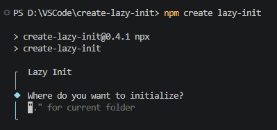

# create-lazy-init

The ultra-lean, zero-fluff project scaffolding tool.

I built this because running standard template initializers forces you to spend the first 10 minutes deleting default styling, asset files, and bloated configurations you never asked for. This CLI skips the junk and spits out clean, bare-bones folder structures so you can actually get to work.

### Quick Start
You don't even need to install it. Just run this in your terminal:

```Bash
npm create lazy-init@latest
```

###### In-Place Setup
If you like creating a folder first, opening it in VS Code, and running the tool directly inside it, just type a dot (.) to initialize in current folder. 

```Bash
npm create lazy-init@latest .
```
When running without specified path the CLI will ask and the same rules apply.


## Available presets

### 1. Static (Frontend Only)
Powered by a highly stripped-back Vite instance. No default logos, no counter buttons, and only basic css.


```Plaintext
my-app/
├── src/
│   ├── App.jsx (or .vue — vanilla skips this)
│   ├── index.css (style.css for vanilla/vue)
│   └── main.jsx (or .js / .ts)
├── eslint.config.js   # only when ESLint is selected
├── index.html
├── package.json
└── vite.config.js (or .ts)
```
### 2. Dynamic (Fullstack Split)
A perfectly isolated monorepo environment. The frontend handles the client-side, and the backend handles the server-side with zero cross-contamination.

```Plaintext
my-app/
├── client/   # Clean Static setup (cleaned up vite)
└── server/   # Pure Express.js backend (different frameworks soon...)
     ├── server.js   
     └── .env  # Only some basic environmental variables
```

### 3. Dynamic (Unified Fullstack — Next.js)
One app, no separate server. Follows the standard `create-next-app` layout (App Router + `src/` directory), minus the demo junk. Backend endpoints live right next to your pages as API routes.

```Plaintext
my-app/
├── src/
│   └── app/
│       ├── api/          # backend lives here (route.js handlers)
│       ├── globals.css
│       ├── layout.jsx (or .tsx)
│       └── page.jsx (or .tsx)
├── .gitignore
├── eslint.config.mjs      # only when ESLint is selected
├── jsconfig.json (or tsconfig.json)
├── next.config.mjs (or .ts)
├── package.json
└── postcss.config.mjs     # only when Tailwind is selected
```

### Current Stack Support
#### __Frontend:__ 
- Vanilla (JS/TS) 
- React (JS/TS)
- Vue (JS/TS)

#### __Backend:__ 
- Express.js
- Next.js API routes (unified preset)

#### __Architecture Style:__ 
- Isolated Client/Server Split
- Unified Fullstack (Next.js)

#### __Optional Tools (opt-in during setup):__
- ESLint (pre-configured flat config per framework)
- Tailwind CSS v4 (fully wired — deps, config, and css import; stripped cleanly when skipped)

## Roadmap (Planned Fluff)
Features being built out as optional, opt-in prompts during setup:
- [x] Automated Git repository initialization (`git init`)
- [x] Optional ESLint setup
- [x] Optional Tailwind CSS setup
- [x] Unified fullstack architecture (Next.js)
- [ ] Optional Creative Suite toggle (Installs GSAP + Lenis Smooth Scroll setup)
- [ ] API-only backend architecture setup (skips the frontend completely)
- [ ] More backend frameworks (Fastify, Hono)
- [ ] Svelte template
- [ ] Package manager choice (npm / pnpm / bun) + optional dependency auto-install
- [ ] Optional database starter for dynamic presets (SQLite + Drizzle or Prisma)
- [ ] Non-interactive mode (pass all answers as CLI flags for scripting)
- [ ] Optional Prettier setup

## Versioning
[SemVer](https://semver.org/), pre-1.0:
- **Patch** (`0.6.x`) — bug fixes and template polish, no new prompts or presets.
- **Minor** (`0.x.0`) — anything new a user can see: new preset, framework, template, or prompt.
- **1.0.0** — when the prompt flow and generated project layout are stable enough to promise no surprise changes.

After 1.0: breaking changes to the CLI interface or generated structure bump major.
